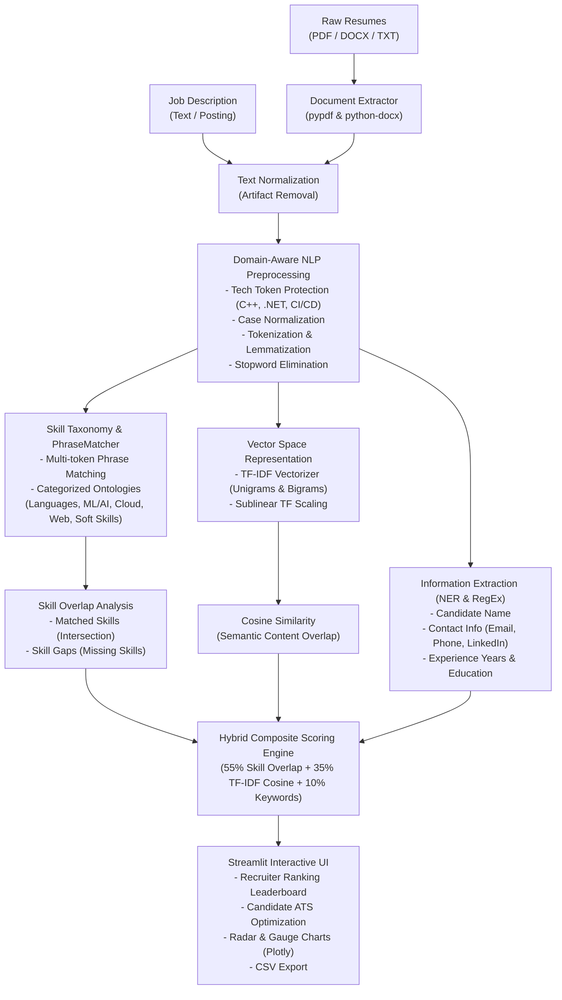

# 🎯 AI-Based Resume Screening and Job Matching System

An end-to-end Natural Language Processing (NLP) and Machine Learning system that parses, screens, and matches resumes against job descriptions. Built with **spaCy**, **NLTK**, **Scikit-Learn**, **Plotly**, and **Streamlit**.

---

## 🌟 Key Features

- **🔐 Authentication & User Roles**:
  - Secure Login and Account Registration portal.
  - Role-based experience for **Job Seekers / Candidates** and **Recruiters / Hiring Managers**.
  - One-click demo login buttons for rapid testing.

- **💼 Career & Job Preferences Setup**:
  - Candidates and recruiters configure preferred roles, seniority levels, work modes (Remote/Hybrid/On-site), target locations, and core technology stack.
  - Automatically synchronizes target job descriptions and recommendations across the matching engine.

- **🏢 Recruiter Mode (Batch Screening & Ranking)**:
  - Screen hundreds of candidate resumes (PDF, DOCX, TXT) against any job posting in seconds.
  - Automatically extracts candidate names, emails, phone numbers, LinkedIn profiles, and estimated years of experience.
  - Ranks candidates dynamically based on a multi-factor hybrid NLP scoring algorithm.
  - Generates interactive Plotly leaderboards and spider/radar charts for skill coverage comparison.
  - One-click export of candidate rankings and gap analysis to CSV.

- **👤 Candidate Mode (ATS Resume Optimizer)**:
  - Paste or upload a job description and compare your resume against it.
  - Instant ATS Compatibility Score (0–100%) with an interactive speedometer/gauge meter.
  - Identifies **Matching Strengths** (skills you have that match) and **Missing Target Skills** (skills to add).
  - Provides actionable tips to beat Applicant Tracking Systems (ATS).

- **🧠 NLP Pipeline Inspector**:
  - Interactive live sandbox showing step-by-step NLP transformations: token protection, stopword removal, lemmatization, and Named Entity Recognition.

---

## 📐 System Architecture



---

## 🔬 NLP & Machine Learning Methodology

### 1. Document Parsing & Text Cleaning
Handles multi-column layouts, line-break hyphens (`engi-\nneer` $\rightarrow$ `engineer`), non-breaking characters, and table contents extracted from PDF, DOCX, and TXT files.

### 2. Specialized Technical Token Protection
Standard tokenizers often damage programming tokens like `C++`, `C#`, `.NET`, `Node.js`, and `CI/CD`. Our preprocessor applies regex protection before tokenization so critical technical keywords are fully preserved.

### 3. Named Entity Recognition & Metadata Extraction
- Uses spaCy's `en_core_web_sm` model and heuristic filtering to identify candidate names from top header sections.
- Employs regex patterns for emails, international phone formats, and LinkedIn/GitHub profiles.
- Chronologically calculates total years of experience from employment date ranges.

### 4. Phrase Matching with spaCy
Rather than naive single-word matching, the system uses spaCy's `PhraseMatcher` to detect multi-word technical concepts like `"natural language processing"`, `"machine learning"`, `"rest api"`, and `"retrieval augmented generation"`.

### 5. TF-IDF & Cosine Similarity
Evaluates the vector-space similarity between the preprocessed resume and job description:
$$\text{Cosine Similarity}(\vec{u}, \vec{v}) = \frac{\vec{u} \cdot \vec{v}}{\|\vec{u}\| \|\vec{v}\|}$$
Using $(1, 2)$-grams ensures phrase-level context is preserved.

### 6. Composite Score Formula
$$\text{Score} = (0.55 \times \text{Skill Match}) + (0.35 \times \text{TF-IDF Similarity}) + (0.10 \times \text{Keyword Salience})$$

---

## 📁 Project Structure

```
ai_based_resume/
│
├── app.py                      # Main Streamlit web application
├── requirements.txt            # Python dependencies
├── README.md                   # Documentation and project overview
│
├── src/                        # Core NLP pipeline modules
│   ├── data_extractor.py       # PDF, DOCX, and TXT parsing
│   ├── nlp_preprocessor.py     # Tokenization, lemmatization & tech-token preservation
│   ├── skill_extractor.py      # Skill taxonomy & spaCy PhraseMatcher
│   ├── entity_parser.py        # Candidate info extraction (Name, Email, Phone, Exp)
│   ├── matcher.py              # TF-IDF, Cosine similarity & hybrid scoring
│   └── analytics.py            # Plotly charts (Gauge, Radar, Leaderboard)
│
├── data/
│   ├── sample_jobs/            # Sample job descriptions
│   │   ├── data_scientist.txt
│   │   ├── nlp_genai_engineer.txt
│   │   ├── full_stack_developer.txt
│   │   ├── java_backend_engineer.txt
│   │   ├── devops_engineer.txt
│   │   └── data_engineer.txt
│   └── sample_resumes/         # 18 sample candidate resumes (PDF, DOCX, TXT)
│       ├── emily_chen_nlp_genai.pdf & .txt
│       ├── alex_morgan_data_scientist.txt & .docx
│       ├── david_kim_java_backend.docx & .txt
│       ├── priya_sharma_data_engineer.pdf & .txt
│       ├── carlos_rodriguez_cloud_architect.pdf & .txt
│       ├── aisha_patel_frontend_react.docx & .txt
│       ├── sarah_jenkins_fullstack.txt
│       ├── marcus_vance_devops.txt
│       ├── michael_brown_cybersecurity.txt
│       ├── rachel_green_mobile_dev.txt
│       ├── thomas_clark_bi_analyst.txt
│       └── jordan_lee_junior_intern.txt
│
└── tests/
    └── test_pipeline.py        # Automated unit tests
```

---

## 🚀 Quick Start Guide

### 1. Prerequisites
- Python 3.9+ (tested on Python 3.12)
- Git (optional)

### 2. Install Dependencies
```bash
pip install -r requirements.txt
```

### 3. Download NLP Models (Run Once)
```bash
python -c "import nltk; nltk.download('punkt', quiet=True); nltk.download('punkt_tab', quiet=True); nltk.download('stopwords', quiet=True); nltk.download('wordnet', quiet=True)"
python -m spacy download en_core_web_sm
```

### 4. Run the Unit Tests
```bash
python -m unittest tests/test_pipeline.py
```

### 5. Launch the Web Application
```bash
streamlit run app.py
```
Open your browser at `http://localhost:8501`.

---

## 📊 Sample Walkthrough

1. **Recruiter Mode**:
   - Select `"Senior Data Scientist"` from the sample job dropdown.
   - Check the box `⚡ Or use 4 pre-loaded diverse candidate resumes for instant testing`.
   - Click **Screen and Rank Candidates**.
   - See `Alex Morgan (Data Scientist)` ranked #1 with an 85%+ match, with complete skill breakdown and downloadable CSV.

2. **Candidate Mode**:
   - Select a target job and load a sample resume.
   - Click **Analyze Resume & ATS Match** to see your ATS Score, missing skills checklist, and radar coverage chart.
